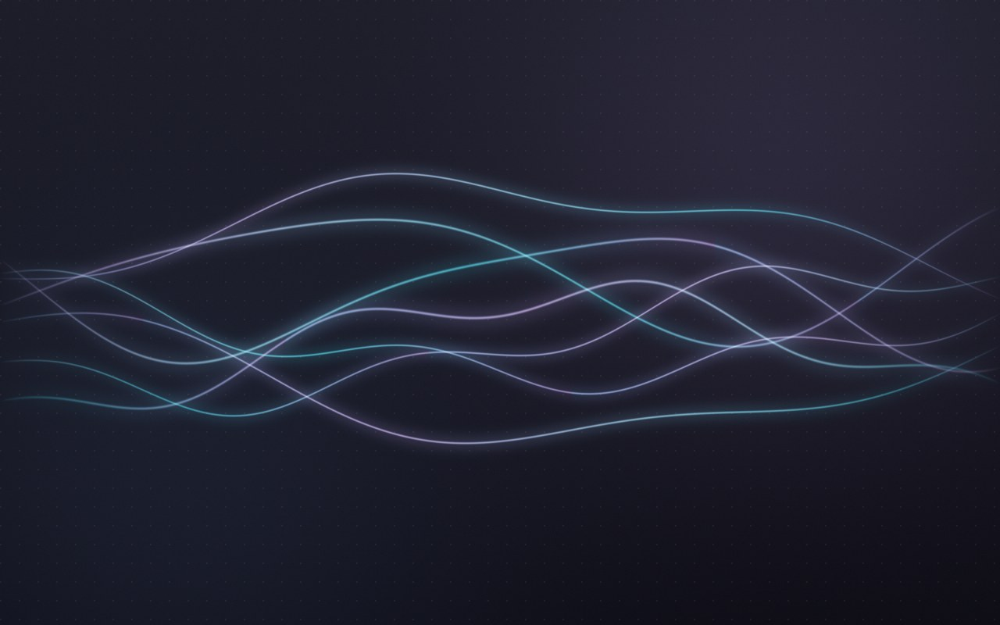

# dotfiles

Windows 11 dev setup in **Tokyo Night**: terminal, VS Code, tiling window manager and a status bar,
installed and configured by two idempotent PowerShell scripts.



## What you get

| Layer | Tools |
|---|---|
| Terminal | Windows Terminal, PowerShell 7, Oh My Posh, JetBrainsMono Nerd Font, PSReadLine predictions, fzf, zoxide, fastfetch, a retro "Hacker (CRT)" profile |
| Editor | VS Code: Tokyo Night, Material Icons, Error Lens, GitLens, Jupyter, Ruff |
| Desktop | GlazeWM (tiling), YASB (top bar), Flow Launcher, PowerToys, dark theme with Tokyo Night accent, generated wallpaper |
| Tooling | uv, Ruff (winget), Pandoc, GitHub CLI, Everything, Claude Code CLI |

## Install

```powershell
git clone https://github.com/Foqir/dotfiles $HOME\dotfiles
cd $HOME\dotfiles
powershell -ExecutionPolicy Bypass -File .\setup-windows.ps1   # apps, terminal, VS Code
powershell -ExecutionPolicy Bypass -File .\style-windows.ps1   # theme, taskbar, wallpaper, GlazeWM + YASB
```

Run both as a normal user (winget asks for elevation where needed). Re-running is safe: installed apps are skipped,
config blocks are replaced, and every edited file gets a `*.bak-<timestamp>` copy.
On its first run `style-windows.ps1` snapshots every registry value it is about to change (and whether it existed),
plus the original YASB/GlazeWM configs, into `~\.dotfiles-backup\original\`. Later runs never overwrite that snapshot,
so `-Undo` always returns Windows to how it looked before the first run; values the script added are deleted.

| Flag | Script | Effect |
|---|---|---|
| `-SkipApps` | setup | configure only, no winget installs |
| `-SkipVSCode` | setup | leave VS Code alone |
| `-SkipWallpaper` | style | keep the current wallpaper |
| `-NoStart` | style | enable autostart but don't launch GlazeWM / YASB now |
| `-Undo` | style | back to the state before the first run, disable autostart |

## Layout

```
setup-windows.ps1     apps (winget), PowerShell 7 profile, Windows Terminal, VS Code
style-windows.ps1     Windows theme, taskbar, Explorer, wallpaper, GlazeWM/YASB configs + autostart
wallpaper.py          procedural Tokyo Night wallpaper (numpy + Pillow): python wallpaper.py out.png 1920 1200
glazewm/config.yaml   -> ~\.glzr\glazewm\config.yaml   (based on GlazeWM v3.10.1 sample config)
yasb/config.yaml      -> ~\.config\yasb\config.yaml     (based on YASB v2.0.7 setup wizard)
yasb/styles.css       -> ~\.config\yasb\styles.css
```

## GlazeWM keys

| Keys | Action |
|---|---|
| `Alt+1..9` / `Alt+Shift+1..9` | go to workspace / move window there |
| `Alt+H J K L`, `Alt+arrows` | focus neighbour window |
| `Alt+Shift+H J K L` | move window |
| `Alt+Enter` | Windows Terminal |
| `Alt+F` / `Alt+Shift+Space` | fullscreen / float |
| `Alt+R` | resize mode (arrows, `Esc` to leave) |
| `Alt+C` | cycle focus tiling ↔ floating (moved from `Alt+Space`, which Flow Launcher uses) |
| `Alt+Shift+P` / `Alt+Shift+E` | pause / exit GlazeWM |
| `Alt+Shift+R` | reload config |

WSLg windows (`msrdc.exe`: Gazebo, RViz and other Linux GUI apps from Docker/WSL) are ignored by GlazeWM.
If Windows switches the input language with `Alt+Shift`, the many `Alt+Shift+<key>` bindings can collide with it;
`style-windows.ps1` warns about this. Use `Win+Space` or change the language hotkey in Settings.

Terminal: `` Win+` `` drop-down terminal, `Ctrl+R` fuzzy history, `Ctrl+T` fuzzy file, `z <dir>` jump.

## License

BSD 3-Clause, see [LICENSE](LICENSE).
